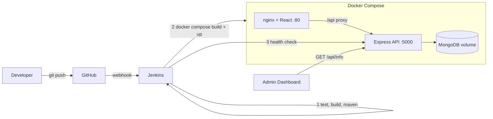

# HomeEase – Smart Home Services Marketplace

A MERN home-services booking app (inspired by Urban Company) built for a **DevOps Lab**.
The real goal: show **Linux, Git/GitHub, Maven, Jenkins CI/CD, Docker and Docker Compose** working together.
Customers book electricians, plumbers, AC technicians, cleaners, carpenters and painters. Providers accept jobs. Admin manages everything and sees the **DevOps Build Inspector**.

> DevOps design follows the approach of the reference project *DevOps Service Catalog & Build Inspector* (Jenkins + Maven + multi-stage Docker + `/api/info` build stamping + health check + GitHub webhook). Only the ideas are reused; the app here is a separate MERN project.

## Features
- 3 roles (Customer / Provider / Admin) with JWT login and role-based dashboards
- Browse, search, filter and book services; pay (simulated); review and rate
- Providers: accept/reject jobs, update status, demo earnings
- Admin: stats, manage users/services/bookings, **DevOps Build Inspector**
- Rule-based demo AI assistant (keyword matching, no paid API): detects category, estimates duration, recommends top-rated providers, answers basic support questions
- `GET /api/health` and `GET /api/info`

Screenshots: `docs/landing.png`, `docs/customer.png`, `docs/admin-inspector.png` (add your own).

## Tech stack
React + Vite + Tailwind + React Router + Axios + Lucide · Node + Express + MongoDB/Mongoose + JWT + bcryptjs · Jest + Supertest · Maven + JUnit 5 · Jenkins · Docker + Compose

## Architecture


## Folder structure
```
HomeEase/
  frontend/    React app, Dockerfile (multi-stage: node build -> nginx), nginx.conf
  backend/     Express API: models/ controllers/ routes/ middleware/ utils/ tests/, Dockerfile (multi-stage)
  maven-demo/  Small Java module: pom.xml + class + JUnit test
  devops/      health-check.sh, linux-commands.sh, git-workflow.sh, setup-jenkins-host.sh
  docker-compose.yml   Jenkinsfile   .gitignore   .env.example   README.md
```

## Demo logins
| Role | Email | Password |
|---|---|---|
| Customer | customer@homeease.com | customer123 |
| Provider (AC technician) | provider@homeease.com | provider123 |
| Admin | admin@homeease.com | admin123 |

Seed data (services, providers, bookings, a review) loads automatically on first start.

## Quick start

### A) Docker (recommended)
```bash
docker compose up --build -d
docker compose ps            # all three should become "healthy"
```
Open **http://localhost** (app) and **http://localhost:5000/api/info**. If port 80 is busy: `FRONTEND_PORT=3000 docker compose up --build -d`.
Stop: `docker compose down` (add `-v` to wipe the database).

### B) Without Docker (dev mode)
Needs Node 20 and a local MongoDB.
```bash
cd backend  && npm install && npm start      # API on :5000 (auto-seeds)
cd frontend && npm install && npm run dev    # app on http://localhost:5173
```

### Run tests
```bash
cd backend && npm test      # health, info, register/login, services, booking, AI classification (no DB needed)
cd maven-demo && mvn clean test
```

## DevOps commands

**Linux (Week 1):** see `devops/linux-commands.sh`
**Git (Weeks 2-3):** see `devops/git-workflow.sh` (init, add, commit, branches `main` + `development`, feature branch, merge, push, pull)
**Maven (Week 4):**
```bash
cd maven-demo
mvn clean      # delete target/
mvn compile    # compile
mvn test       # JUnit tests
mvn package    # builds target/maven-demo-1.0.0.jar
java -cp target/maven-demo-1.0.0.jar com.homeease.demo.BookingPriceCalculator
```
**Docker (Week 7):**
```bash
docker build -t homeease/backend:1 ./backend
docker build -t homeease/frontend:1 ./frontend
docker images | grep homeease
docker run -d --name test-be -p 5001:5000 homeease/backend:1   # (needs a reachable Mongo for "healthy")
docker ps; docker logs test-be; docker stop test-be; docker rm test-be
```
**Docker Compose (Week 8):** `docker compose up --build -d`, `docker compose ps`, `docker compose logs -f backend`, `docker compose down`

## Jenkins setup (step by step)

**1. Install** (Ubuntu): `bash devops/setup-jenkins-host.sh` – installs Java 17, Maven, Node 20, Docker, Jenkins, and runs `usermod -aG docker jenkins`.
Open `http://localhost:8080`, enter the initial admin password, install suggested plugins (make sure **Git**, **Pipeline**, **GitHub** and **Credentials Binding** are present).

**2. Docker permission (important).** The pipeline runs `docker compose` as the `jenkins` user. That user must be in the `docker` group and Jenkins must be restarted afterwards:
```bash
sudo usermod -aG docker jenkins && sudo systemctl restart jenkins
sudo -u jenkins docker ps      # must work without "permission denied"
```
(Jenkins running *inside* a container needs `/var/run/docker.sock` mounted plus the Docker CLI installed. The host install above is simpler.)

**3. Credentials** (Manage Jenkins → Credentials → Global → Add):
| ID | Kind | Value |
|---|---|---|
| `homeease-jwt-secret` | Secret text | any long random string (**required**) |
| `dockerhub-creds` | Username with password | Docker Hub user + access token (**only for the optional push**) |

**4. Create the job:** New Item → *Pipeline* → name `HomeEase` → tick **GitHub hook trigger for GITScm polling** → Definition **Pipeline script from SCM** → SCM **Git** → your repo URL → branch `*/main` → Script Path `Jenkinsfile` → Save → **Build Now**.

**5. Pipeline stages:** Checkout → Check Tools → Install Dependencies → Backend Tests → Build Frontend → Maven Build & Test → Build Docker Images → (optional) Push to Docker Hub → Deploy with Docker Compose → Health Check. Failures stop the pipeline and print container logs.
Tick `PUSH_TO_DOCKERHUB` when running "Build with Parameters" to publish images.

## GitHub webhook (automatic deploy on push)
1. Push this project to GitHub (`devops/git-workflow.sh`).
2. Jenkins must be reachable from the internet. On a laptop use a tunnel: `ngrok http 8080` and use the https URL it prints.
3. GitHub repo → Settings → Webhooks → Add webhook:
   - Payload URL: `http://<jenkins-host>:8080/github-webhook/` (keep the trailing slash)
   - Content type: `application/json`, event: *Just the push event* → Add.
4. A green tick should appear under "Recent Deliveries". The `triggers { githubPush() }` line in the Jenkinsfile starts the build.
5. (Fallback if you cannot expose Jenkins: job → Build Triggers → *Poll SCM* with `H/2 * * * *`.)

## How the Build Inspector works
Jenkins computes `GIT_COMMIT`, `BUILD_NUMBER`, `BUILD_TIMESTAMP`, `DEPLOY_ENV`, `APP_VERSION` → `docker compose` passes them as container environment variables → `GET /api/info` returns them → Admin Dashboard shows them (auto-refresh every 15 s). Push a commit, wait for Jenkins, refresh: the build number and SHA change.

## API endpoints
| Method | Path | Access |
|---|---|---|
| GET | /api/health, /api/info | public |
| POST | /api/auth/register, /api/auth/login | public |
| GET | /api/services, /api/providers, /api/reviews | public |
| POST/DELETE | /api/services, /api/services/:id | admin |
| GET | /api/providers/me | provider |
| POST | /api/bookings | customer |
| GET | /api/bookings | any logged-in (filtered by role) |
| PATCH | /api/bookings/:id/status | customer (cancel), provider/admin |
| POST | /api/payments (simulated), /api/reviews | customer |
| POST | /api/ai/analyze | public |
| GET | /api/admin/stats, /api/admin/users · DELETE /api/admin/users/:id | admin |

## DevOps Lab Experiments Mapping
| Week | Topic | Where in this project |
|---|---|---|
| 1 | Linux basics | `devops/linux-commands.sh`: file management, `chmod`, users, processes |
| 2 | Git init/add/commit/push/pull | `devops/git-workflow.sh` |
| 3 | Git branching & GitHub | `main`, `development`, `feature/*` branches, merge, remote on GitHub |
| 4 | Maven | `maven-demo/`: `mvn clean compile test package` |
| 5 | Jenkins | Install script, Freestyle job demo (run `mvn test` in `maven-demo`), Git integration |
| 6 | CI pipeline | `Jenkinsfile`: tests, builds, reports, webhook trigger |
| 7 | Docker | `backend/Dockerfile`, `frontend/Dockerfile` (multi-stage) |
| 8 | Docker Compose | `docker-compose.yml`: frontend + backend + MongoDB, volume, healthchecks |

## Lab evaluation – how to demo each mandatory feature
| # | Feature | Show this |
|---|---|---|
| 1 | Maven | `cd maven-demo && mvn clean compile test package`; Jenkins stage "Maven Build & Test" + test report |
| 2 | Declarative pipeline | Open `Jenkinsfile`; show Stage View; break a test to show the pipeline failing |
| 3 | Multi-stage Docker | `docker images`: frontend is nginx-only, backend has no dev deps (`npm ci --omit=dev`) |
| 4 | Compose | `docker compose up --build -d` then `docker compose ps` (3 healthy containers) |
| 5 | Build Inspector | `curl localhost:5000/api/info`; Admin login → DevOps Build Inspector |
| 6 | Health check | `curl localhost:5000/api/health` → status, database, timestamp; `docker inspect --format '{{.State.Health.Status}}' homeease-backend` |
| 7 | Auto deploy | Change text, `git push`, watch Jenkins start by itself, refresh Admin dashboard: new build number and SHA |

## Notes and honest limits
- MongoDB has no password and is not published to the host (only reachable on the Compose network). Fine for a lab; add auth for real use.
- `JWT_SECRET` falls back to a local dev value when running Compose by hand. Jenkins always injects the real one from credentials.
- Payments and the "AI" are simulated/rule-based demos.

## Optional future enhancements
Kubernetes (deploy the same images with Deployments/Services), Ansible (provision the Jenkins host), Terraform (create the VM/cloud infra), Prometheus + Grafana (metrics from `/api/health`), ELK/Loki (central logs), Trivy/SonarQube (security and quality scans), MongoDB auth + HTTPS reverse proxy.
## DevOps Lab Notes
